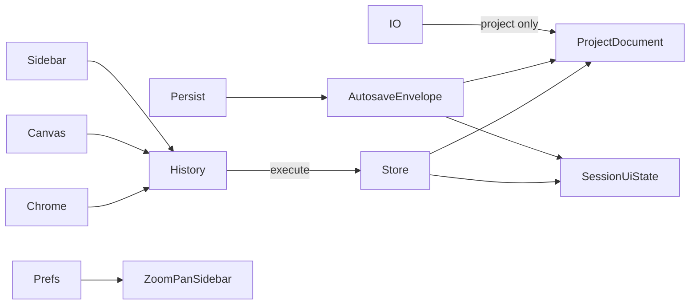
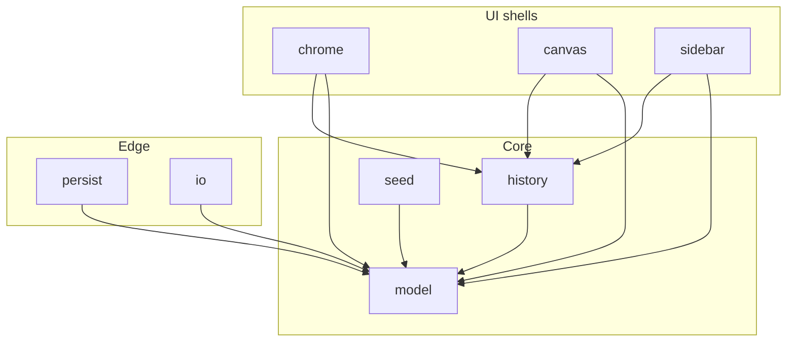
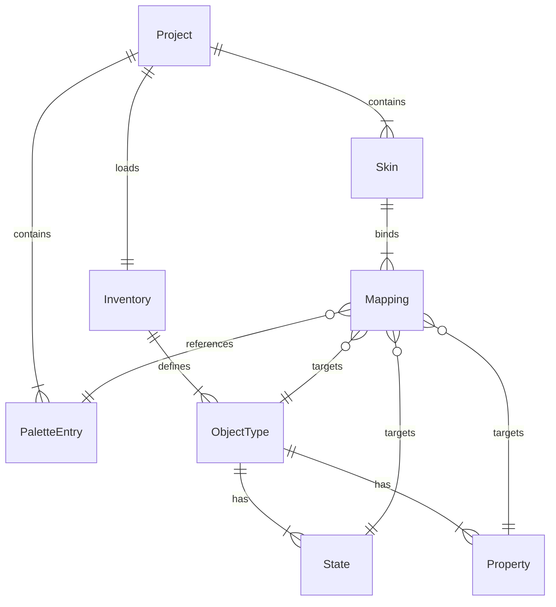
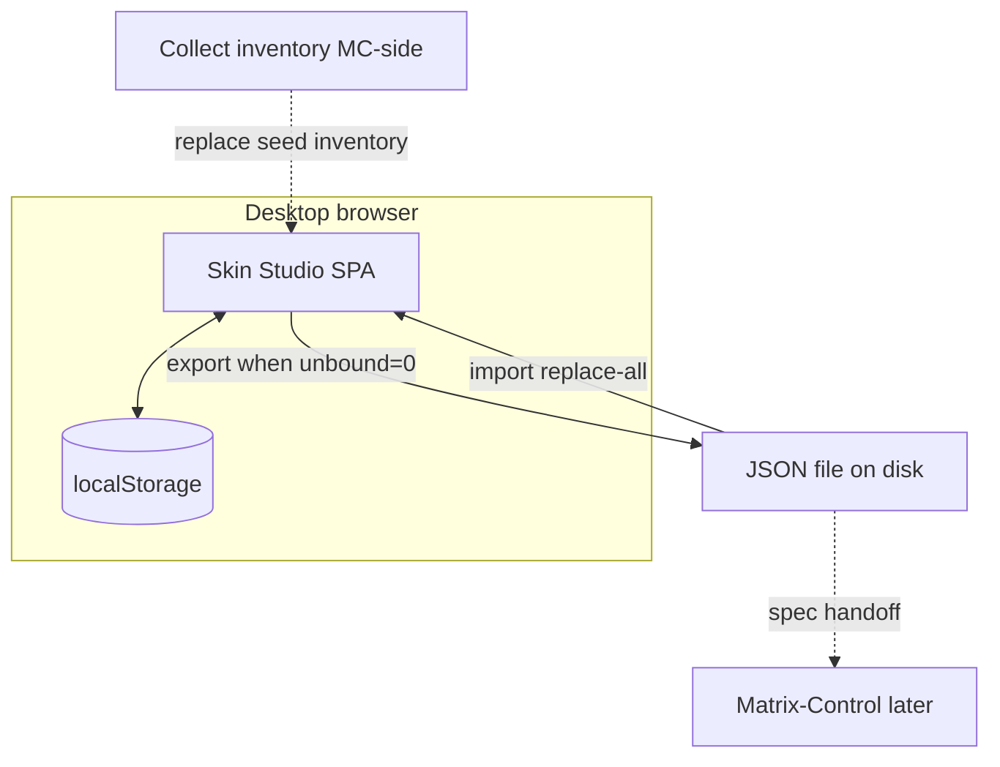

# Architecture Spine — Matrix-Control Skin Studio

## Design Paradigm

**Document-centric single-writer store.** `ProjectDocument` is the sole mutable product truth. UI shells emit commands; `history` executes them into `model/store` — the only writer. `SessionUiState` holds selection + active skin (autosaved with project, never exported). Zoom / pan / sidebar heights live only in prefs. Undo/redo is a command stack over project + selection.



## Invariants & Rules

### AD-1 — Single-writer project store `[ADOPTED]`

- **Binds:** all mutation paths (FR-1…FR-21)
- **Prevents:** canvas and sidebar each holding a divergent project copy; dual mutation paths
- **Rule:** Only `model/store` may mutate `ProjectDocument` and `SessionUiState`. UI never patches fields in place.

### AD-2 — Stack: Vite + TypeScript + vanilla DOM `[ASSUMPTION]`

- **Binds:** toolchain, UI rendering approach
- **Prevents:** framework-vs-framework drift; heavy SPA stack delaying a light internal tool
- **Rule:** Vite SPA with TypeScript modules and direct DOM / CSS. No React, Preact, Lit, or other UI framework in MVP. Pins (npm 2026-10-15): Vite `8.3.4`, TypeScript `7.0.2` (override `create-vite` vanilla-ts default TS ~6 if used). Node engines: `^20.19.0 || >=22.12.0` (Vite 8 requirement).

### AD-3 — Dependency direction

- **Binds:** module graph
- **Prevents:** UI owning persistence or inventing schema; circular chrome↔model ownership
- **Rule:** `model/` and `history/` must not import `chrome/`, `canvas/`, or `sidebar/`. `persist/` and `io/` depend on `model/` only. `seed/` feeds `model/`. UI shells depend inward only. `history` may call `store.apply`; UI may call `history.execute` / undo / redo only — never `store.apply` directly.



### AD-4 — Application data model (semantics, not frozen schema)

- **Binds:** FR-1, FR-13…FR-18, FR-21; epics/stories domain language
- **Prevents:** inventing Collect inventory as product truth; free hex on Mapping path; array-vs-Record drift
- **Rule:** Entities below are binding. Final JSON **field names** freeze only after minimal Collect. Mappings store `paletteEntryId | null` only — never raw `#RRGGBB`. Runtime collection shapes (binding): `palette: PaletteEntry[]` ordered; `skins: Skin[]` ordered; `Skin.mappings: Mapping[]` with uniqueness on `(objectTypeId, stateId, propertyId)`; `inventory.objectTypes: { id, states: string[], properties: string[] }[]`. Skin duplicate copies mappings into a new Skin identity. Type-level mappings only — no per-instance overrides.



| Entity | Required fields (semantic) |
| --- | --- |
| Project | `formatVersion` (writer pin `1`), palette, skins, inventory |
| PaletteEntry | stable `id`, opaque `#RRGGBB` hex; optional `constantName` |
| Skin | stable `id`, `displayName`, mappings[] |
| Mapping | `objectTypeId` × `stateId` × `propertyId` → `paletteEntryId \| null` |
| Inventory | `objectTypes[]` with nested `states[]` / `properties[]` string ids |

v1 seed Skin display names: `Black/Green`, `Cream/Green`, `Black/Duo`, `Cream/Duo`, `Monochrome`. Duo LED yellow baseline `#FFCC00` is a Palette entry, not a magic constant outside the model. Changing a Palette entry hex updates every mapped Property on the next preview paint.

### AD-5 — JSON packing: single project document (MVP)

- **Binds:** FR-21 autosave / import / export transport
- **Prevents:** one module autosaving global JSON while another exports per-skin files
- **Rule:** MVP packing is **one JSON document = whole Project** for export/import. Autosave uses an envelope (AD-8). Application model remains one Project. Per-skin multi-file packing is Deferred.

### AD-6 — Sticky context in SessionUiState `[ADOPTED]`

- **Binds:** FR-2, UX sticky context
- **Prevents:** Skin switch resetting Object type / State / pan / zoom; dual homes for selection
- **Rule:** `SessionUiState` holds `selectedObjectTypeId`, `selectedStateId`, `activeSkinId` only. Skin switch changes `activeSkinId` only. Never invent a selection when none exists. Zoom / pan are **not** in SessionUiState (prefs only — AD-8). Context strip reads session + prefs.

### AD-7 — Coalesced undo / redo `[ASSUMPTION]`

- **Binds:** FR-4, FR-20
- **Prevents:** picker micro-gestures flooding the undo stack; undoing Zoom/pan; missing redo
- **Rule:** Command stack covers `ProjectDocument` mutations + Object type / State selection. Coalesce picker / Palette hex micro-edits at **400 ms idle or pointer-up**. Discrete commits (rename, mapping id change, Skin CRUD) stay separate. Zoom and pan are never undo steps. Redo reapplies until a new branch edit clears the redo stack.

### AD-8 — Persistence split: project vs prefs `[ADOPTED]`

- **Binds:** FR-11, FR-21
- **Prevents:** Zoom / pan / sidebar layout leaking into handoff JSON; selection stored in two places
- **Rule:** Autosave key `skin-studio:project` stores envelope `{ project, session }` where `session` is AD-6 fields only. Prefs key `skin-studio:prefs` stores `{ zoomStep, panXY, sidebarPaneHeights }` only. Export / import serialize **project only**. Reopen restores envelope + prefs. First open with no project, and **New** after confirm, load seed (v1 skins + base palette + seed-placeholder inventory). Default `zoomStep` = `100%`. Pan includes click-drag and arrow keys when canvas focused. Discrete Zoom steps: `50%`, `75%`, `100%`, `125%`, `150%`, `175%`, `200%`.

### AD-9 — Import / export gate `[ADOPTED]`

- **Binds:** FR-3, FR-21; UX export-blocked / import fail-closed
- **Prevents:** soft export with Unbound; silent partial import; non-JSON companion as mandatory handoff
- **Rule:** `formatVersion` required integer; writer pin `1`. Unknown or newer `formatVersion` → fail closed. MVP import = replace-all after strong confirm (merge = Soon FR-28). Export disabled while `unboundCount > 0`. Export target MVP = all skins in the project. Export is **JSON file only** (no mandatory Markdown companion). `io/` asks `model` for unbound count — does not reimplement unbound math.

### AD-10 — Unbound derivation from loaded inventory `[ADOPTED]`

- **Binds:** FR-3, SM-1 interim gate
- **Prevents:** hardcoding a fake Object-type inventory scattered across modules
- **Rule:** Sole derive function lives in `model/` (e.g. `deriveUnbound`). Required slots = every Inventory Property for each Skin × ObjectType × State in the **loaded** inventory. Unbound if mapping missing, `paletteEntryId` null, or Palette id deleted / unresolvable. Until Collect marks optionals, all inventory properties are required. MVP may ship **one** seed inventory file marked `source: "seed-placeholder"`; builders must not invent ObjectTypes outside that file. Collect later replaces it. Do not treat seed placeholders as Matrix-Control product truth.

### AD-11 — UX chrome contracts bind implementation `[ADOPTED]`

- **Binds:** FR-8…FR-11 as refined by UX final (Skin **combo**, not PRD segmented pills)
- **Prevents:** regressing to Skin mode pills; adding layers tree / bottom chrome / left Palette rail in MVP
- **Rule:** Top bar order: `[New][Import][Export]` · undo/redo · `Zoom` · `Skin` combo right-anchored. Sidebar four panes: fixed-height picker → palette → mappings/skin → unbound (splitters; panes 2–4 resizable). Pane 3 IA: segmented `[Mappings | Skin]`; Skin tab = rename / duplicate / delete only. No layers tree; no bottom chrome; no left Palette rail; no Auto Layout / true overlay editing UI. UI microcopy English per EXPERIENCE.md. Visual tokens from DESIGN.md.

### AD-12 — Hosting envelope (MVP)

- **Binds:** platform / ops for this altitude
- **Prevents:** assuming cloud backend, plugin embed, or Matrix-Control submodule as MVP blockers
- **Rule:** Static SPA via Vite (local or static file host). No server API, no accounts, no plugin-embedded UI. Handoff = downloaded JSON. Matrix-Control mirror/submodule is optional later ops — out of MVP critical path.

### AD-13 — Orchestrator simulation on canvas only `[ADOPTED]`

- **Binds:** FR-15 Duo accents; Look / Orchestrator glossary
- **Prevents:** baking Patch/Master zones into generic Object types or Project inventory
- **Rule:** Patch/Master / Header zone accents are simulated in the canvas/mock layer using **mock layout metadata** owned by `canvas/` (not Inventory ObjectTypes). Inventory Object types stay generic. Skin Studio does not implement C++ Looks. LED Properties always paint fully-on Palette colour (no intensity UI).

### AD-14 — Runtime collection shapes `[ASSUMPTION]`

- **Binds:** shared `ProjectDocument` shape across parallel builders
- **Prevents:** one epic using `Record<id, T>` while another uses arrays; flat vs nested inventory
- **Rule:** Use the shapes in AD-4. Do not introduce alternate collection topologies without a new AD.

### AD-15 — Mutation and derive ownership `[ASSUMPTION]`

- **Binds:** history, store, unbound, paint resolve
- **Prevents:** two owners of unbound math, export gate, or colour resolve
- **Rule:** Mutation path is UI → `history.execute(command)` → `store.apply`. Unbound list/count: `model` only. Export gate reads that derive. Canvas resolves paint colours only via `model` palette/mapping lookup helpers — never by reading hex off a Mapping.

### AD-16 — Cross-shell interaction contracts `[ADOPTED]`

- **Binds:** FR-5, FR-7, FR-14, UX state patterns
- **Prevents:** shells inventing incompatible sync / confirm / pulse behaviour
- **Rule:** Canvas click selects Object type and highlights Mapping row; does **not** reset State. Sidebar Object type outlines mock region when present. Mapping change → immediate preview + discrete outline pulse 1–2× ~400 ms (`pulse-outline`). Unbound row click jumps to Object type + Mapping row (and State if encoded). Delete Skin: always confirm. Delete referenced Palette id: confirm first listing n mappings that will become Unbound, then apply. Picker commits hex only when a Palette entry is selected. New: confirm, then replace with seed project.

## Consistency Conventions

| Concern | Convention |
| --- | --- |
| Naming (files) | kebab-case files; modules as tree folders below |
| Naming (ids) | stable string ids; Skin `displayName` is product string (`Black/Duo`) |
| Hex | opaque `#RRGGBB`; uppercase preferred on write; case-insensitive on read |
| Mapping values | Palette entry id or null (Unbound) — never hex |
| Errors (import) | fail closed; English operator message per EXPERIENCE.md |
| Undo / redo | project + selection; prefs excluded |
| Zoom | chrome label `Zoom`; discrete PRD UI Scale set; default `100%` |
| Duo LED | Palette entry seeded `#FFCC00` |
| JSON keys | semantic names in AD-4; final key freeze post-Collect; prefer `paletteEntryId` over addendum `paletteColorId` |
| Export | JSON only |
| UI language | English chrome; code/comments English |
| Bootstrap Green skins | seed may derive `Black/Green` & `Cream/Green` from current Black/Cream inventory notes when available — still via seed file, not invented ad hoc in UI |

## Stack

| Name | Version |
| --- | --- |
| Platform | Desktop browser SPA (evergreen Chromium / Safari / Firefox) |
| Runtime | Node `^20.19.0 \|\| >=22.12.0` (dev/build) |
| Bundler / dev server | Vite 8.3.4 |
| Language | TypeScript 7.0.2 |
| UI library | none (vanilla DOM + CSS) |
| Persistence | `localStorage` (`skin-studio:project`, `skin-studio:prefs`) |
| Handoff | JSON file download / file picker import |

## Structural Seed

```text
{project-root}/
  index.html
  package.json
  vite.config.ts            # present even if create-vite omits — pin tooling here
  src/
    main.ts                 # boot: load persist → seed if empty → mount shells
    model/                  # types, store, deriveUnbound, palette lookup
    history/                # command stack, coalesce, undo/redo
    persist/                # localStorage envelope + prefs
    io/                     # formatVersion validate; export gate
    seed/                   # v1 skins, base palette, seed-placeholder inventory
    chrome/                 # top bar + context strip
    canvas/                 # GUI view mock + zone metadata + pan/zoom + pulse
    sidebar/                # picker | palette | mappings-skin | unbound
    styles/                 # DESIGN.md tokens as CSS variables
  public/
```



## Capability → Architecture Map

| Capability / Area | Lives in | Governed by |
| --- | --- | --- |
| Palette-id-only mappings (FR-1) | `model/`, `sidebar/` | AD-4, AD-15 |
| Sticky context (FR-2) | `model/` session, `chrome/`, `canvas/` | AD-6, AD-8 |
| Unbound + hard export gate (FR-3) | `model/`, `io/`, `sidebar/`, `chrome/` | AD-9, AD-10, AD-15 |
| Coalesced undo / redo (FR-4, FR-20) | `history/` | AD-7, AD-15 |
| Canvas ↔ sidebar sync + pulse (FR-5) | `canvas/`, `sidebar/` | AD-16 |
| Type-level mappings (FR-6) | `model/` | AD-4 |
| LED fully-on (FR-7) | `canvas/` paint | AD-13 |
| Chrome layout (FR-8…11; UX combo) | `chrome/`, `sidebar/`, `canvas/` | AD-11 |
| Palette / Skin CRUD + confirms (FR-13…16) | `sidebar/`, `model/`, `seed/` | AD-4, AD-16 |
| Bootstrap inventory (FR-17) | `seed/`, `model/` | AD-10 |
| Live preview (FR-19) | `canvas/` ← store subscribe | AD-1, AD-15 |
| Autosave / import / export (FR-21) | `persist/`, `io/` | AD-5, AD-8, AD-9 |
| Orchestrator Duo zones | `canvas/` mock metadata | AD-13 |
| Hosting | Vite static SPA | AD-12 |

## Deferred

| Item | Why it can wait | Revisit when |
| --- | --- | --- |
| Definitive JSON schema field freeze | Blocked on Collect ObjectType/Property/State inventory | Minimal Collect inventory lands |
| Per-skin multi-file packing | MVP single-document packing (AD-5) | Collect inventory size known **and** Matrix-Control requires skin-at-a-time files |
| Optional Property flags | All loaded properties required until Collect marks optional | Collect marks optionals |
| IndexedDB | localStorage assumed sufficient `[ASSUMPTION]` | Quota / size proves otherwise |
| Merge import (FR-28) | Soon; MVP replace-all | Soon epic pulled |
| Draft vs ready (FR-26) | Soon | Soon epic pulled |
| Where-used / rename / compare / replace-colour / search / contrast (FR-22…25, FR-27) | Soon intent-only | Soon epic pulled |
| Collect inventory home (`docs/` vs MC note) | Ops choice | Collect starts |
| Matrix-Control mirror/submodule | Optional ops | MC integration pass |
| C++ Look / Orchestrator implementation | Other repo | MC implementation effort |
| Exhaustive `SkinColourId` / LED green confirmation | Collect | Collect checklist |
| Alpha/darken/dim → opaque RGB candidates | Collect | Collect |
| Automated test framework / CI | Not pinned at this altitude | First build epic that needs it |
| UI framework revisit | Vanilla chosen for simplicity | Only if chrome complexity proves unmaintainable |
| Server / cloud / accounts | Explicit non-goal | Course correction only |
| Narrow drawer / left Palette rail | UX Soon / parked | Course correction |
